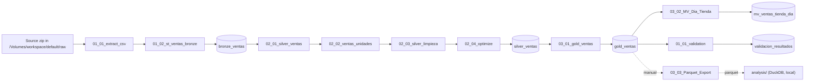

# Databricks Challenge – Sales pipeline

A medallion pipeline (bronze → silver → gold) on Databricks for item-level point-of-sale data from a restaurant chain in the US. A Lakeflow Job runs every step in order, from the raw CSV extracts to the analysis tables, and ends with a data quality validation that fails the job if a critical rule is not met.

This README explains how to set up and run the project from scratch. The source data is not included in the repository.

## Architecture



All tables live in `workspace.default`. Every notebook in the diagram except `03_03_Parquet_Export` is a task of the job.

## Repository structure

```
.
├── analysis/                             # Analysis notebooks, run locally with DuckDB on the exported gold table
├── resources/
│   ├── jobs/
│   │   └── daily_orchestration_job.yml   # Job definition: tasks, dependencies, retries, notifications, schedule
│   └── pipelines/
│       └── README.md                     # Why the transformations are not a declarative pipeline
├── src/
│   ├── transformations/
│   │   ├── 01_bronze/
│   │   │   ├── 01_01_extract_csv
│   │   │   └── 01_02_st_ventas_bronze
│   │   ├── 02_silver/
│   │   │   ├── 02_01_silver_ventas
│   │   │   ├── 02_02_ventas_unidades
│   │   │   ├── 02_03_silver_limpieza
│   │   │   └── 02_04_optimize
│   │   └── 03_gold/
│   │       ├── 03_01_gold_ventas
│   │       ├── 03_02_MV_Dia_Tienda
│   │       └── 03_03_Parquet_Export      # Run by hand, not part of the job
│   └── validations/
│       └── 01_01_validation
├── .gitignore                            # Keeps data/ out of Git
└── README.md
```

## Requirements

- A Databricks workspace with Unity Catalog and the `workspace.default` schema. Databricks Free Edition works.
- Serverless compute for notebooks and jobs.
- A Pro or Serverless SQL warehouse for the materialized view task. In Free Edition, the Serverless Starter Warehouse.
- A GitHub account linked to Databricks, to clone the repository as a Git folder.
- The source data: a zip with the POS extracts as CSV files (about 11 GB of CSV, January 2025 to September 2026).

## Setup

1. **Link GitHub.** In Databricks, open your user menu → Settings → Linked accounts and add a GitHub credential.
2. **Clone the repository.** Workspace → Create → Git folder, paste the repository URL and choose GitHub as the provider.
3. **Upload the data.** In Catalog → workspace → default, create a managed volume named `raw`, open it and upload the zip with *Upload to this volume*.
4. **Check the zip path.** `ZIP_PATH` in `01_01_extract_csv` must match the name of the uploaded file.
5. **Create the job.** In Jobs & Pipelines → Create → Job, rebuild the job defined in `resources/jobs/daily_orchestration_job.yml`: the same nine tasks with the same keys and dependencies, each a notebook task pointing to its notebook in your Git folder, with the same retries, failure email and paused schedule. Use your own email for the notifications.
   - Pick your SQL warehouse as the compute of `gold_mv_dia_tienda`. Every other task runs on serverless. In the YAML, the warehouse goes in `warehouse_id` (SQL Warehouses → your warehouse → Connection details: the last part of the HTTP path).
   - The YAML follows the Databricks Asset Bundles format. To deploy it as a bundle, the repository also needs a `databricks.yml` at the root, and each notebook path needs its file extension.

In the team workspace the job is already created as **taco_bueno_daily** (Jobs & Pipelines → taco_bueno_daily → *Run now*: <https://dbc-b9b79dc2-7f0a.cloud.databricks.com/?o=7474660220074313#job/728417848934577>). For everyone else, rebuild it as described in Setup.

## Running the pipeline

Start the job with **Run now**. The schedule (daily at 6:00, America/Mexico_City) is defined but paused, because the data is a fixed historical extract and no new files arrive.

A correct run ends with every task green and every validation rule marked `ok`:

```sql
SELECT * FROM workspace.default.validacion_resultados ORDER BY corrida DESC
```

Reference values:

| Check | Expected |
|---|---|
| Rows in `bronze_ventas` | 85,180,477 |
| Rows in `silver_ventas` and `gold_ventas` | 100,330,857 |
| Orders (`store` + `date` + `check_number`) | 13,771,296 |
| Days with data | 573, from 2025-01-22 to 2026-09-27. The source has no data for the other 41 days in that range. |

## What each task does

| Task | Notebook | What it does | Writes |
|---|---|---|---|
| `extract_csv` | `01_01_extract_csv` | Extracts the CSV files from the zip into `/Volumes/workspace/default/raw/csv`. If CSV files are already there, it skips the extraction. | CSV files |
| `bronze_ventas` | `01_02_st_ventas_bronze` | The CSV files come in three header formats. It reads the header of each file, detects the separator, normalizes the column names and groups the files by format. Each group is read with its own schema, every column as a string, and the groups are unioned by column name, so a format change cannot shift values into the wrong column. Adds `_n_cols` (columns in the file's format) and `_source_file` (the file each row came from). | `bronze_ventas` |
| `silver_ventas` | `02_01_silver_ventas` | Creates the silver table from bronze: `date` to DATE, `begin_time` and `end_time` to TIMESTAMP (format `M/d/yyyy h:mm a`), and one day added to `end_time` for orders that cross midnight. | `silver_ventas` |
| `silver_unidades` | `02_02_ventas_unidades` | Splits rows with `quantity` > 1 into one row per unit, so every row of silver is one unit sold. A row is split into 50 units at most. | `silver_ventas` |
| `silver_limpieza` | `02_03_silver_limpieza` | Casts the money columns to DECIMAL(12,4) and adds `duracion_min`. Removes the rows with nulls in required columns, unifies the channel names that changed with the POS migration (To Go → Drive Thru, Inside → Dine-In, 3 → Carry Out) and groups `tender_type`: cash and combinations of bills become Cash, combinations that include a card or platform become Hybrid, and single cards stay as they are. Writes a fixed list of 19 columns, clustered by `store` and `date`. | `silver_ventas` |
| `silver_optimize` | `02_04_optimize` | Runs `OPTIMIZE` on the silver table to compact its files and keep the clustering. | `silver_ventas` |
| `gold_ventas` | `03_01_gold_ventas` | Creates the consumption table from silver, clustered by `store` and `date`, and adds three CHECK constraints. | `gold_ventas` |
| `gold_mv_dia_tienda` | `03_02_MV_Dia_Tienda` | Creates the materialized view of orders, units, sales and average ticket per store and day, with two expectations. Sales count one `total` per order. Runs on the SQL warehouse. | `mv_ventas_tienda_dia` |
| `validacion` | `01_01_validation` | Checks 16 rules across five quality dimensions, appends the results and fails the job if a critical rule is not met. | `validacion_resultados` |

## Output tables

| Table | One row per | Purpose |
|---|---|---|
| `bronze_ventas` | CSV line | Raw data as loaded, every column a string, with the source file and format of each row. |
| `silver_ventas` | Unit sold | Clean, typed data with the same grain for the whole period. |
| `gold_ventas` | Unit sold | The table the analysis uses. Same columns as silver, with constraints that guarantee a complete order key, dates within the period and current channel names. |
| `mv_ventas_tienda_dia` | Store and day | Orders, units, sales and average ticket. |
| `validacion_resultados` | Rule and run | Results of every validation run. |

Columns of `silver_ventas` and `gold_ventas`:

| Column | Type | Notes |
|---|---|---|
| `store` | string | Store |
| `pos_code` | string | POS code |
| `check_number` | string | Order number. It repeats across stores and days, so an order is identified by `store` + `date` + `check_number`. |
| `menu_item` | string | Item. Can be null. |
| `transaction_type` | string | Transaction type |
| `tender_type` | string | Payment method, grouped into 14 values. Can be null. |
| `report_group` | string | Report group of the item. Can be null. |
| `pop` | string | Sales channel, 9 values (for example Drive Thru, Dine-In and Carry Out) |
| `date` | date | Business date |
| `begin_time`, `end_time` | timestamp | Start and end of the order, to the minute. In online channels `begin_time` is the promised time, not the time the order started. |
| `menu_price` | decimal(12,4) | Price of the unit |
| `total` | decimal(12,4) | **Total of the whole order, repeated on every row of the order**, already net of voids. Sales take one `total` per order; adding it row by row counts each order once per unit. |
| `item_discount`, `total_discount` | decimal(12,4) | Discounts |
| `tax` | decimal(12,4) | Tax |
| `item_voided`, `order_voided` | decimal(12,4) | Voids at item and order level |
| `duracion_min` | bigint | `end_time` − `begin_time`, in minutes |

## Data quality

Quality is enforced at four points:

1. **Cleaning.** Each header format is read with its own schema. `02_03_silver_limpieza` removes the rows with nulls in required columns (about 5,700); nulls are allowed in `menu_item`, `tender_type` and `report_group`. Channel names and payment methods are unified, and orders that cross midnight get the right end time.
2. **CHECK constraints on `gold_ventas`.** `llave_orden` (complete order key), `fecha_en_periodo` (dates from 2025-01-01 to 2026-09-30) and `canales_nuevos` (no old channel names). Adding a constraint checks every row, so a violation fails the task.
3. **Expectations on `mv_ventas_tienda_dia`.** `tienda_y_fecha` fails the update if a row has no store or date. `ventas_no_negativas` only warns: rows are kept and violations are counted in the view's event log.
4. **Validation task.** 16 rules, each with a dimension and a severity. They run on `silver_ventas`, and `gold_ventas` must have the same number of rows.
   - Completeness: number of days with data, first and last day.
   - Uniqueness: number of orders, and orders with more than one `total` (warn).
   - Consistency: no old channel names and no single bills (`$1`, `$5`, …) left in `tender_type`, and the expected number of distinct channels and payment methods.
   - Validity: no nulls in required columns.
   - Accuracy: rows in bronze and silver, gold equal to silver, reference sums of prices and minutes, and sales per order within 2% of the sum of prices (warn).

   `fail` rules stop the job; `warn` rules are only recorded.

Rows are not deduplicated on purpose. There is no line identifier, so two units of the same item in the same order are identical rows, and both are real sales.

## Design decisions

| Decision | Why |
|---|---|
| Notebook tasks in a Lakeflow Job | The cleaning was already done and validated in these notebooks. The job rebuilds the same tables in order, with retries, failure email and a validation gate. |
| Liquid clustering `CLUSTER BY (store, date)` on silver and gold | `store` and `date` lead the order key and are the grain of the daily view. The tables are created with the clustering, so data is clustered on write and a regular `OPTIMIZE` is enough. It replaces ZORDER, which cannot be combined with liquid clustering. |
| CHECK constraints on gold, expectations on the view | Constraints keep bad data out of the consumption table. Expectations let the view fail on missing keys and only report other issues. |
| Materialized view for the business level | Gold keeps the unit grain for the analysis; the view adds metrics per store and day. It is created from the SQL warehouse and runs on a serverless Lakeflow pipeline. |
| No streaming or declarative pipeline | Evaluated and left as next steps. See `resources/pipelines/README.md`. |
| SQL with `$` literals runs through `spark.sql()` | SQL cells in Databricks notebooks treat `$1`, `$5` and similar as parameters and leave literals like `'$5'` empty. `02_03_silver_limpieza` and `01_01_validation` use `spark.sql()` for this reason. |

## Failures and reruns

- Every task retries once after one minute, except `validacion`: if the data does not match, running it again does not change the result.
- A failure sends an email to the addresses in the job.
- After fixing the cause, **Repair run** reruns only the failed task and the tasks after it.
- Reruns do not duplicate data. The extraction is skipped when the CSV files are already there, every table is rebuilt with `CREATE OR REPLACE` or overwrite, and the constraints are dropped and added again. `validacion_resultados` gets a new set of rows per run on purpose.
- The three silver notebooks rewrite the same table one after the other. To rebuild silver by hand, start again from `02_01_silver_ventas`, which recreates it from bronze.
- Only one run at a time (`max_concurrent_runs: 1`).
- To go back to an earlier version of a table, find it with `DESCRIBE HISTORY` and use `RESTORE TABLE ... TO VERSION AS OF`. Databricks vacuums old files automatically, so only versions from the last 7 days can be restored.

## Local analysis environment

The notebooks in `analysis/` run on a local copy of the gold table, so they do not use the workspace's compute.

1. Run `03_03_Parquet_Export` by hand. It writes `gold_ventas` as parquet files to `/Volumes/workspace/default/exports/gold_ventas`.
2. In Catalog → workspace → default → exports → gold_ventas, download the `part-*.parquet` files into `data/gold_ventas/` at the root of the repository. The other files in that folder are commit markers and are not needed. `data/` is ignored by Git.
3. Install the dependencies: `pip install duckdb pandas matplotlib jupyter`.
4. Open the notebooks in `analysis/`. They query the parquet files with DuckDB.

## Notes

- **Compute quota.** Free Edition has a daily compute quota shared by the whole workspace. Run the full job once, then do exploratory work on the local copy.
- **Date range.** `fecha_en_periodo` allows 2025-01-01 to 2026-09-30, the period of the extract. Widen it before loading newer extracts.
- **Expected values.** The validation compares against the tables the analysis was built on. With different source data, update the expected values in `01_01_validation`.
